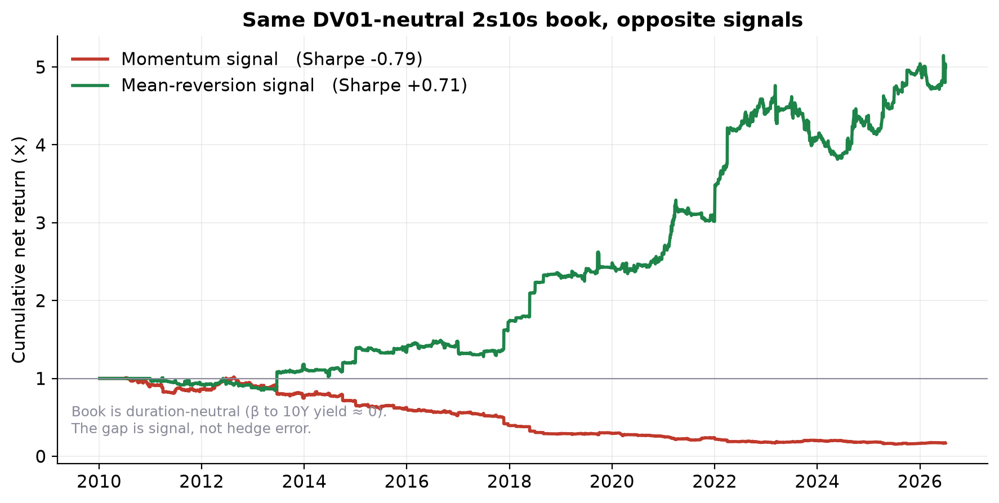

# Treasury Futures Curve: Momentum and Mean Reversion

**Momentum in levels, reversion in spreads** — a systematic study of U.S. Treasury
futures curve strategies, 2010–2026.

> **Scope.** This study implements and reports **time-series momentum on outright duration** and
> **mean-reversion on DV01-neutral curve spreads** (2s10s, 5s30s, 2s5s10s). A *carry* strategy is
> **not** implemented here. Carry and policy-path work is scoped in
> `bloomberg/EXPORT_CHECKLIST.md` (fed funds futures, SOFR/OIS and swap curves) as future work; the
> published pipeline does not open those inputs. The repository slug still reads
> `treasury-curve-carry-momentum` for link stability.

Hong Si Wei Nicholas · Nanyang Technological University

---

## The finding

Outright duration **trends**; the yield curve **mean-reverts**. Applying the
momentum signal that works on outright duration to the 2s10s curve is a systematic
way to lose money.

The two lines below are the *same* DV01-neutral book — long the 10-year leg, short
a DV01-scaled 2-year leg. Only the signal differs:



| Signal on the identical 2s10s book | Net Sharpe |
|---|---|
| Momentum | **−0.79** |
| Mean-reversion | **+0.71** |

The book's P&L has a regression slope of −0.001 on the 10-year yield change, i.e.
it is genuinely duration-neutral. The gap is signal, not hedge error.

## Results (2010–2026, net of costs, vol-scaled to 10%)

| Strategy | Sharpe | Max DD | Turnover/yr |
|---|---|---|---|
| Duration momentum (baseline) | 0.68 | −23% | 22 |
| 2s10s mean-reversion | 0.71 | −20% | 104 |
| 5s30s mean-reversion | 0.66 | −27% | 68 |
| 2s5s10s butterfly | 0.07 | −38% | 87 |


Against the baseline, HAC Diebold–Mariano gives DM = 0.83 (p = 0.41) for 2s10s and
0.68 (p = 0.49) for 5s30s. **Neither is statistically significant.** The honest
reading: outright duration momentum is the workhorse, curve mean-reversion is a
legitimate and roughly co-equal source of return that does not demonstrably beat
it, and the butterfly is not supported.

## Method notes

- **Continuous futures** rebuilt from the exchange roll map (`FUT_CUR_GEN_TICKER`)
  with difference back-adjustment, so roll gaps are not booked as returns.
- **DV01** is Bloomberg's daily forward risk to delivery
  (`CONVENTIONAL_CTD_FORWARD_FRSK`) — the real per-day contract sensitivity, not a
  regression proxy.
- **No lookahead**: signals use t−1 data, execution at t settle, monthly rebalance,
  126-day warm-up, leverage capped at 3×.
- **Costs**: one tick per contract per side, using each contract's own tick size
  from the `*_STATIC` export (the 10-year tick was halved during the sample). The
  same cost model drives the table above and every figure — see the correction below.
- **Inference**: Diebold–Mariano with Newey–West (Bartlett) long-run variance at a
  21-day lag spanning the holding period, plus the Harvey–Leybourne–Newbold
  small-sample correction. Cross-checked against a HAC-robust OLS of the
  differential on a constant; statistics agree to two decimals.

## Repository layout

```
notebooks/   treasury_curve_pipeline.ipynb   runs top-to-bottom from a folder of CSVs
scripts/     make_figures.py                 redraws the figures from that same run
paper/       IEEE-format paper (PDF + LaTeX source)
results/     figures + exported macro regime series
bloomberg/   VBA exporters and the export checklist (how to pull the inputs yourself)
DATA.md      input schema, tickers, and the free-data route
```

## Reproducing

```bash
pip install -r requirements.txt
BBG_CSV=/path/to/your/csv/exports BBG_RESULTS=./results \
  jupyter nbconvert --to notebook --execute notebooks/treasury_curve_pipeline.ipynb
```

Set both environment variables. `BBG_CSV` is the folder holding your CSV exports,
`BBG_RESULTS` is where the run writes its outputs. If you leave them unset they default
to `data_raw/` and `results/` at the repository root — `data_raw/` is git-ignored, so it
is a safe place to drop a local export.

The notebook reads the CSVs in `BBG_CSV` by security stem (`TY1_Comdty.csv`,
`USGG2YR_Index.csv`, ...; the exact required set is in `DATA.md`) and writes
`equity_curves.png` and `macro_regime.csv` to `BBG_RESULTS`. It runs top to bottom with
no manual steps.

**The committed notebook is source only: it ships deliberately with no stored cell outputs.**
Executing it requires the licensed Bloomberg CSV exports, and saved outputs would embed that
vendor data in a public repository. It is a reproduction notebook, not an executed record. The
numbers in the tables above were produced by running it locally against the original exports on
2026-08-21 and again on 2026-08-23; both runs reproduced every figure exactly (Sharpe 0.68 / 0.71 /
0.66 / 0.07; DM 0.83 p 0.405, 0.68 p 0.494). To reproduce them yourself you need terminal access, or
the free-data route in `DATA.md`.

Regenerate the figures from the same run with:

```bash
BBG_CSV=/path/to/your/csv/exports BBG_RESULTS=./results \
  python scripts/make_figures.py
```

`scripts/make_figures.py` executes the notebook's code cells and draws from that
namespace, so the figures and the table above cannot drift apart.

## Data note

The inputs are daily Bloomberg Terminal exports (futures settle/volume/open interest and
roll map, cash-curve yields, DV01, MOVE) obtained through an institutional subscription.
Bloomberg licence terms restrict redistribution, so **the CSVs are not in this
repository**. `bloomberg/BloombergPull_v6.bas`, `bloomberg/BloombergDV01.bas` and
`bloomberg/EXPORT_CHECKLIST.md` reproduce the pull on any terminal; `DATA.md` lists the
tickers and the plain `Date,FIELD` schema the notebook expects, which also accepts free
substitutes (FRED `DGS2/5/10/30` for the cash curve, any futures source with
settle/volume/open interest).

## Known limitations

- The mean-reversion direction for the curve is economically motivated but was
  confirmed on the full sample. **A walk-forward out-of-sample test is required
  before treating the curve results as a hard performance claim.**
- Single-country, single-currency; costs are a one-tick-per-side approximation
  omitting market impact and financing.

## Correction (2026-08-23)

**The originally published performance table was gross of transaction costs, not net.**

The notebook's `load_static()` searched for `<root>1_STATIC*.csv`, but the VBA exporter
writes `<root>1_Comdty_STATIC.csv`. The glob never matched, so no contract statics were
loaded, `tick_frac()` returned `0.0` for every root, `cost_per_unit` was `0.0`, and the
series labelled `net` was identical to `gross`. The bug was silent: nothing failed, and
the figures inherited the same zero cost because the figure script calls the notebook's
own `tick_frac()`.

The glob now accepts both filenames. With costs actually applied — one tick per contract
per side at each contract's own tick size, giving `cost_per_unit` between 0.000085 and
0.000176 depending on the book — the results are:

| Strategy | Originally published (cost-free) | Corrected (net of tick costs) |
|---|---|---|
| Duration momentum (baseline) | 0.71 / −23% | **0.68 / −23%** |
| 2s10s mean-reversion | 0.77 / −19% | **0.71 / −20%** |
| 5s30s mean-reversion | 0.73 / −26% | **0.66 / −27%** |
| 2s5s10s butterfly | 0.12 / −36% | **0.07 / −38%** |
| Same 2s10s book, momentum signal | −0.73 | **−0.79** |
| Same 2s10s book, mean-reversion signal | +0.77 | **+0.71** |
| DM 2s10s vs baseline | 1.00 (p 0.32) | **0.83 (p 0.41)** |
| DM 5s30s vs baseline | 0.89 (p 0.37) | **0.68 (p 0.49)** |
| DM butterfly vs baseline | −1.44 (p 0.15) | **−1.53 (p 0.13)** |

Turnover is unchanged (costs do not affect position sizing), as is
`results/macro_regime.csv`.

**Every qualitative conclusion is unchanged.** The ranking of the four strategies is the
same; neither curve trade is statistically distinguishable from the baseline, and both
p-values move *further* from significance; the butterfly remains unsupported; and the
level-versus-spread asymmetry — the actual finding — is slightly wider than first
reported (a 1.51 Sharpe gap on the identical book, against 1.50 before).

## Typeset PDF

`paper/treasury_curve_paper.pdf` was re-typeset on 2026-08-23 from the corrected
`paper/treasury_curve_paper.tex`. The PDF now prints the net-of-cost numbers from the
correction table above throughout — abstract, results table, Diebold--Mariano statistics
and conclusion — and embeds the regenerated `results/fig*.png` figures, whose legends
carry the same values. Nothing else in the paper changed.

### Building the paper

Run from `paper/`:

```bash
mkdir -p build
printf '%s\n' '\AddToHook{class/IEEEtran/after}{\RequirePackage[OT1]{fontenc}}' \
  '\input{treasury_curve_paper.tex}' | tectonic -X compile - -o build
```

Tectonic is XeTeX-based and IEEEtran's Times (`ptm`) family is undefined under XeTeX's
default TU encoding, so without the `[OT1]{fontenc}` wrapper tectonic silently substitutes
Latin Modern and reflows the whole paper; the wrapper is what reproduces the Times
typesetting of the committed PDF. Because the source arrives on stdin the result is written
as `build/texput.pdf`. pdfTeX needs none of this — `pdflatex treasury_curve_paper.tex` builds the
source as-is.

## Related

[`global-rates-rv`](https://github.com/Nicholashsw/global-rates-rv) — cross-country extension using the same
shared research core. Currently a negative result: cross-country yield spreads are
not cointegrated out-of-regime.
