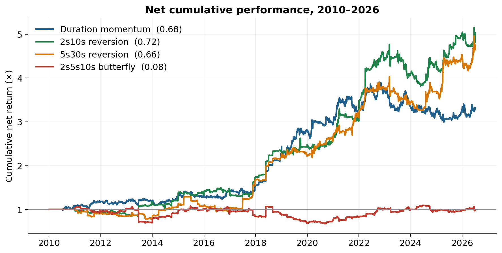
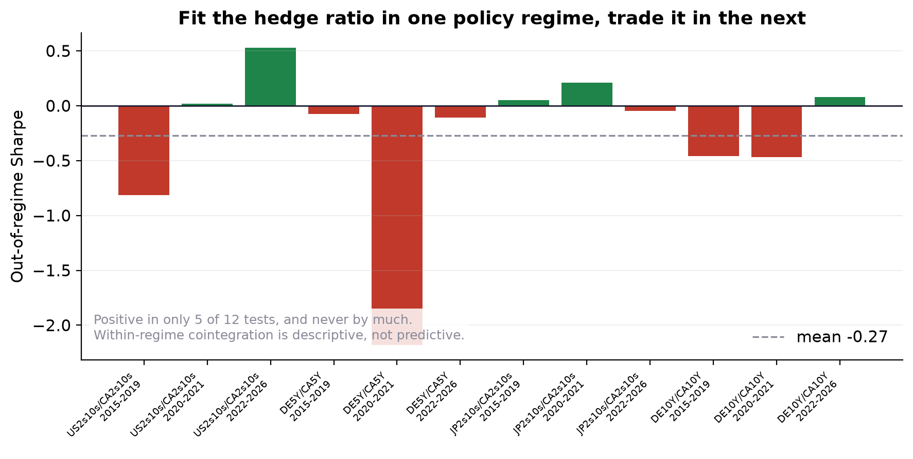

# Treasury Futures Curve: Momentum and Mean Reversion

**Momentum in levels, reversion in spreads** — a systematic study of U.S. Treasury
futures curve strategies, 2010–2026.

> **Scope.** This study implements and reports **time-series momentum on outright duration** and
> **mean-reversion on DV01-neutral curve spreads** (2s10s, 5s30s, 2s5s10s). A *carry* strategy is
> **not part of the headline result**: it was tested separately, under a protocol fixed before the
> results were run, and it failed — see [Carry extension](#carry-extension--a-documented-null)
> below. Policy-path work (fed funds futures, SOFR/OIS and swap curves) remains scoped in
> `bloomberg/EXPORT_CHECKLIST.md` as future work; the published pipeline does not open those
> inputs. The repository slug still reads
> `treasury-curve-carry-momentum` for link stability.

Hong Si Wei Nicholas · Nanyang Technological University

---

## The finding

Outright duration **trends**; the yield curve **mean-reverts**. Applying the
momentum signal that works on outright duration to the 2s10s curve is a systematic
way to lose money.

The two lines below are the *same* DV01-neutral book — long the 10-year leg, short
a DV01-scaled 2-year leg. Only the signal differs:


| Signal on the identical 2s10s book | Net Sharpe |
|---|---|
| Momentum | **−0.79** |
| Mean-reversion | **+0.72** |

A regression of the book's daily P&L on the daily change in the 10-year yield gives a
slope of about −0.001, so the book is close to duration-neutral and the gap comes from the
signal. No script in the repository stores that regression.

## Results (2010–2026, net of costs, 10% volatility target)

| Strategy | Sharpe | Max DD | Turnover/yr |
|---|---|---|---|
| Duration momentum (baseline) | 0.68 | −23% | 22 |
| 2s10s mean-reversion | 0.72 | −20% | 104 |
| 5s30s mean-reversion | 0.66 | −27% | 68 |
| 2s5s10s butterfly | 0.08 | −38% | 87 |



Realised volatility of the net returns runs from 11.8% to 16.1%, above the 10% target.

Against the baseline, HAC Diebold–Mariano gives DM = 0.84 (p = 0.40) for 2s10s and
0.69 (p = 0.49) for 5s30s. **Neither is statistically significant.** The honest
reading: outright duration momentum is the workhorse, curve mean-reversion is a
legitimate and roughly co-equal source of return that does not demonstrably beat
it, and the butterfly is not supported.

## Method notes

- **Continuous futures** rebuilt from the exchange roll map (`FUT_CUR_GEN_TICKER`)
  with difference back-adjustment, so roll gaps are not booked as returns.
- **DV01** is Bloomberg's daily forward risk to delivery
  (`CONVENTIONAL_CTD_FORWARD_FRSK`) — the real per-day contract sensitivity, not a
  regression proxy.
- **No lookahead**: signals use t−1 data, execution at t settle, monthly rebalance,
  126-day warm-up, leverage capped at 3×.
- **Costs**: one tick per contract per side. The code applies each root's most recent
  tick size and settle price from the `*_STATIC` export to the whole sample. That
  understates the 2-year note's cost before 2019, when its tick was twice as large; the
  other contracts' ticks did not change during the sample. The same cost model drives the
  table above and every figure (see the correction below).
- **Inference**: Diebold–Mariano with Newey–West (Bartlett) long-run variance at a
  21-day lag spanning the holding period, plus the Harvey–Leybourne–Newbold
  small-sample correction.

## Repository layout

```
notebooks/   treasury_curve_pipeline.ipynb   runs top-to-bottom from a folder of CSVs
scripts/     make_figures.py                 redraws the figures from that same run
paper/       IEEE-format paper (PDF + LaTeX source)
results/     figures
bloomberg/   VBA exporters and the export checklist (how to pull the inputs yourself)
carry/       carry extension: protocol, results, figures and reproduction code
walkforward/ regime walk-forward of the curve signals: plan, code and result tables
cross_country/ cross-country rates relative value (US, DE, JP, CA): code, public-data cache, results
DATA.md      input schema, tickers, and the free-data route
```

## Reproducing

```bash
pip install -r requirements.txt
BBG_CSV=/path/to/your/csv/exports BBG_RESULTS=./results \
  jupyter nbconvert --to notebook --execute notebooks/treasury_curve_pipeline.ipynb
```

Set both environment variables. `BBG_CSV` is the folder holding your CSV exports,
`BBG_RESULTS` is where the run writes its outputs. If you leave them unset they default
to `data_raw/` and `results/` at the repository root — `data_raw/` is git-ignored, so it
is a safe place to drop a local export.

The notebook reads the CSVs in `BBG_CSV` by security stem (`TY1_Comdty.csv`,
`USGG2YR_Index.csv`, ...; the exact required set is in `DATA.md`) and writes
`equity_curves.png` and `macro_regime.csv` to `BBG_RESULTS`. It runs top to bottom with
no manual steps.

**The committed notebook is source only: it ships deliberately with no stored cell outputs.**
Executing it requires the licensed Bloomberg CSV exports, and saved outputs would embed that
vendor data in a public repository. The numbers in the tables above are from a run on
17 November 2026 against those exports. Two of them sit on a rounding boundary: the 2s10s Sharpe
is 0.7150 and the butterfly 0.0755, and the August 2026 runs behind the paper printed 0.71 and
0.07. To reproduce them yourself you need terminal access, or the free-data route in `DATA.md`.

Regenerate the figures from the same run with:

```bash
BBG_CSV=/path/to/your/csv/exports BBG_RESULTS=./results \
  python scripts/make_figures.py
```

`scripts/make_figures.py` executes the notebook's code cells and draws from that
namespace, so the figures and the table above cannot drift apart.

## Data note

The inputs are daily Bloomberg Terminal exports (futures settle/volume/open interest and
roll map, cash-curve yields, DV01, MOVE) obtained through an institutional subscription.
Bloomberg licence terms restrict redistribution, so **the CSVs are not in this
repository**. `bloomberg/BloombergPull_v6.bas`, `bloomberg/BloombergDV01.bas` and
`bloomberg/EXPORT_CHECKLIST.md` reproduce the pull on any terminal; `DATA.md` lists the
tickers and the plain `Date,FIELD` schema the notebook expects, which also accepts free
substitutes (FRED `DGS2/5/10/30` for the cash curve, any futures source with
settle/volume/open interest).

## Across countries

The same regime question, asked of the US, German, Japanese and Canadian government curves,
lives in `cross_country/`. It uses the four policy regimes of the walk-forward above, and it
runs from that folder on public data. Across the full sample, none of the candidate pairs is
cointegrated. Inside single regimes some relationships do appear, and a few survive false
discovery control. Fitted in one regime and traded in the next, they lose money on average.
Currency moves explain almost none of the P&L (R² at most 0.0074). Within-regime
cointegration describes the regime it was found in and does not predict the next one.
Details are in `cross_country/FINDINGS.md`.

| Test | Result |
|---|---|
| Full sample, 2010-2026 | 0 of 18 pairs cointegrated |
| Within policy regimes | 11 of 144 pass, 6 survive FDR |
| Fit in one regime, trade the next | mean Sharpe −0.27, positive in 5 of 12 |



Limitation: daily closes are asynchronous across Tokyo, Europe and New York; weekly sampling
is the fix.

## Known limitations

- The mean-reversion direction for the curve was first confirmed on the full sample. A
  walk-forward test now fits the direction and the z-score lookback in one policy regime and
  trades them in the next, over the same four regimes as the cross-country study. Its plan is
  in `walkforward/PREREG.md`; the plan and the results share one commit, so the history does
  not show which came first. Mean-reversion was chosen in all six fits, and both spreads are
  positive in all three test regimes: 2s10s net Sharpe 0.89 / 0.92 / 0.85, pooled 0.87 over
  2015-2026; 5s30s 0.77 / 1.28 / 0.38, pooled 0.69. Duration momentum earns 0.74 on the same
  dates, and Diebold-Mariano against it is not significant (2s10s DM 0.95, p 0.34; 5s30s DM
  0.61, p 0.54). So the curve result holds out of sample, but it still does not demonstrably
  beat outright momentum. Tables in `walkforward/results/`.
- Single-country, single-currency; costs are a one-tick-per-side approximation
  omitting market impact and financing.

## Carry extension — a documented null

Carry is the obvious third premium in this literature, and this repository originally scoped it as
future work. It was tested. **It failed, and it is not part of the headline result.**

The protocol, acceptance criteria and instrument-inclusion rule were written before the
results. In the original commit history the research plan, with the bars in the table below,
was committed at 14:24 on 24 August 2026 with no implementation, and the implementation and
results at 20:57 the same day. That history was squashed when the repository was cleaned on
13 November 2026. The plan and the results now share commit `5836a04`, so the order cannot be
checked from this repository; the original commits are kept offline.

| Test | Bar | Result | |
|---|---|---|---|
| Standalone carry (DV01-neutral, cross-sectional) | Sharpe > 0.4, NW-t > 2.0 | **0.021**, NW-t **0.09** | fails |
| Spanning alpha vs momentum + 2s10s + 5s30s | positive, HAC t > 2.0 | **−0.20%/yr**, t **−0.66** | fails |
| Added as a third portfolio sleeve | ≥ +0.10 Sharpe | **0.871 → 0.714**, drawdown **−15.1% → −21.1%** | fails |

**Why it fails is the interesting part.** Cross-sectional bond-futures carry is largely a duration
ranking in disguise: the rank correlation between carry and DV01 is **+0.51**, and mean carry rises
with tenor overall, though not at every step (TU 0.22, FV 0.90, TY 1.33, UXY 0.49, US 2.46,
WN 1.28, in percent). In an upward-sloping curve "high carry" mechanically means "long
duration". DV01-neutralise the book, as the protocol requires, and its volatility is 1.6%. The
first implementation, which was not neutral, ran at about 11%; that version is no longer in
the code. What remains has no alpha.

A secondary cash-curve carry measure does score 0.84, but it holds the same two long-end contracts
on ~87% of days and turns over 1.3 times a year. It is a near-static long-end-versus-short-end
position, not a working dynamic carry signal, and it is reported as such rather than promoted.

Full write-up, including the cheapest-to-deliver diagnostic behind the instrument-inclusion rule and
a DV01-neutrality bug that had quietly turned the first implementation into a duration bet:
**[`carry/CARRY_RESULTS.md`](carry/CARRY_RESULTS.md)**.

## Correction (2026-08-23)

**The originally published performance table was gross of transaction costs, not net.**

The notebook's `load_static()` searched for `<root>1_STATIC*.csv`, but the VBA exporter
writes `<root>1_Comdty_STATIC.csv`. The glob never matched, so no contract statics were
loaded, `tick_frac()` returned `0.0` for every root, `cost_per_unit` was `0.0`, and the
series labelled `net` was identical to `gross`. The bug was silent: nothing failed, and
the figures inherited the same zero cost because the figure script calls the notebook's
own `tick_frac()`.

The glob now accepts both filenames. With costs actually applied — one tick per contract
per side at each root's most recent tick size, giving `cost_per_unit` between 0.000084 and
0.000176 depending on the book — the results are:

| Strategy | Originally published (cost-free) | Corrected (net of tick costs) |
|---|---|---|
| Duration momentum (baseline) | 0.71 / −23% | **0.68 / −23%** |
| 2s10s mean-reversion | 0.77 / −19% | **0.71 / −20%** |
| 5s30s mean-reversion | 0.73 / −26% | **0.66 / −27%** |
| 2s5s10s butterfly | 0.12 / −36% | **0.07 / −38%** |
| Same 2s10s book, momentum signal | −0.73 | **−0.79** |
| Same 2s10s book, mean-reversion signal | +0.77 | **+0.71** |
| DM 2s10s vs baseline | 1.00 (p 0.32) | **0.83 (p 0.41)** |
| DM 5s30s vs baseline | 0.89 (p 0.37) | **0.68 (p 0.49)** |
| DM butterfly vs baseline | −1.44 (p 0.15) | **−1.53 (p 0.13)** |

Turnover is unchanged (costs do not affect position sizing).

A rerun on 17 November 2026 gives 0.72 for the 2s10s mean-reversion and 0.08 for the
butterfly, both on a rounding boundary, and Diebold-Mariano statistics of 0.84 (p 0.40),
0.69 (p 0.49) and −1.52 (p 0.13). The tables at the top of this README use the rerun values;
the table above is the record of the August correction.

**Every qualitative conclusion is unchanged.** The ranking of the four strategies is the
same; neither curve trade is statistically distinguishable from the baseline, and both
p-values move *further* from significance; the butterfly remains unsupported; and the
level-versus-spread asymmetry — the actual finding — is slightly wider than first
reported (a 1.51 Sharpe gap on the identical book, against 1.50 before).

## Typeset PDF

`paper/treasury_curve_paper.pdf` was re-typeset on 2026-08-23 from the corrected
`paper/treasury_curve_paper.tex`. The PDF now prints the net-of-cost numbers from the
correction table above throughout — abstract, results table, Diebold--Mariano statistics
and conclusion — and embeds the regenerated `results/fig*.png` figures, whose legends
carry the same values. Nothing else in the paper changed. The PDF still prints the August
values where the November rerun differs in the second decimal (Sharpe 0.71 and 0.07; DM 0.83,
0.68 and −1.53).

### Building the paper

Run from `paper/`:

```bash
mkdir -p build
printf '%s\n' '\AddToHook{class/IEEEtran/after}{\RequirePackage[OT1]{fontenc}}' \
  '\input{treasury_curve_paper.tex}' | tectonic -X compile - -o build
```

Tectonic is XeTeX-based and IEEEtran's Times (`ptm`) family is undefined under XeTeX's
default TU encoding, so without the `[OT1]{fontenc}` wrapper tectonic silently substitutes
Latin Modern and reflows the whole paper; the wrapper is what reproduces the Times
typesetting of the committed PDF. Because the source arrives on stdin the result is written
as `build/texput.pdf`. pdfTeX needs none of this — `pdflatex treasury_curve_paper.tex` builds the
source as-is.

## Related

[`cross_country/`](cross_country/) holds the cross-country extension, formerly the separate
global-rates-rv repository. It is a negative result: cross-country yield spreads are not
cointegrated out of regime (see [Across countries](#across-countries)).
