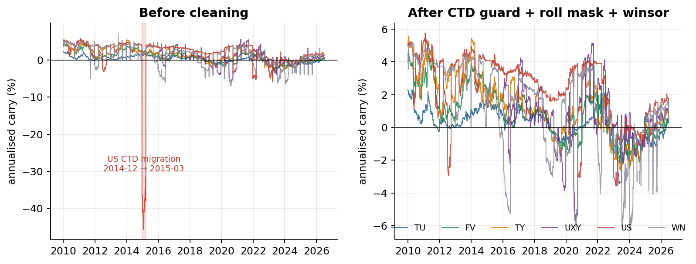
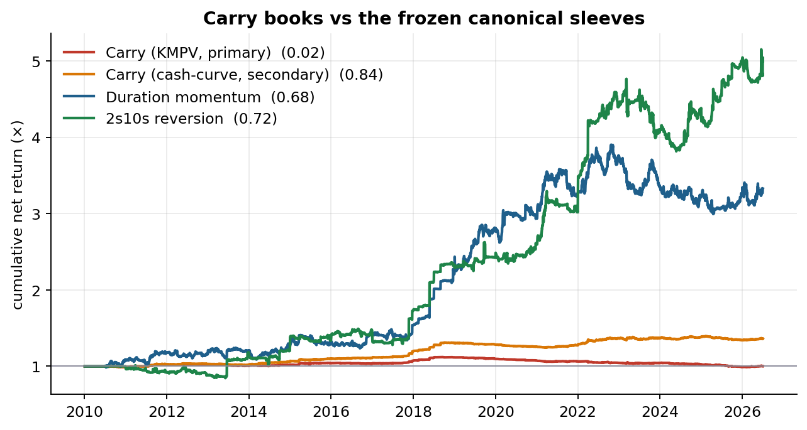
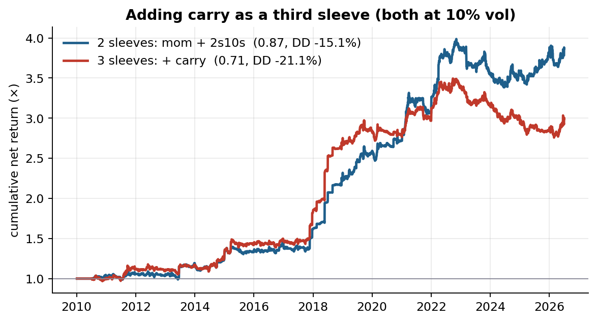
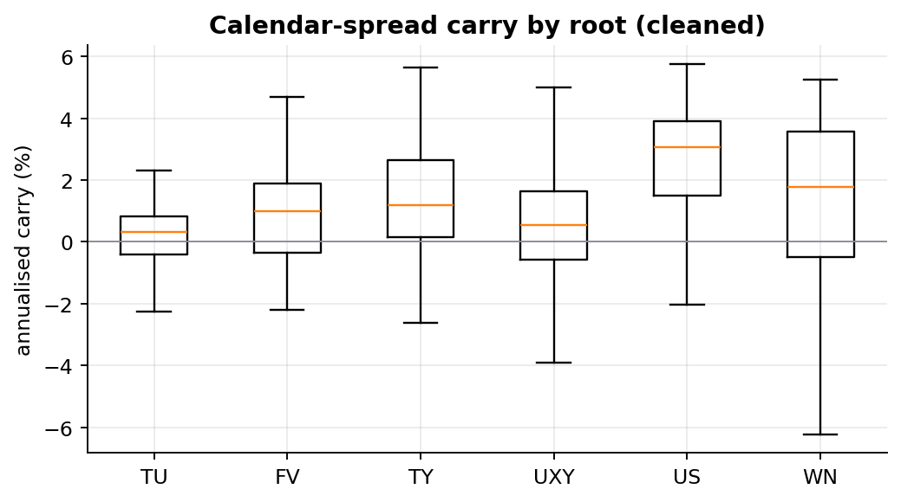
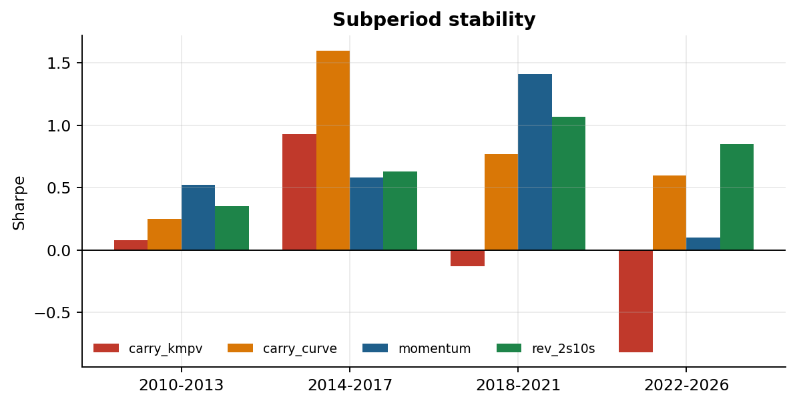

# CARRY_RESULTS.md

**Phase 4 results.** Secondary documented null. The public project title is unchanged:
*Treasury Futures Curve: Momentum and Mean Reversion*.

Run 2026-08-24 against a read-only Bloomberg export (the folder named by `$BBG_CSV`).
Pre-specified protocol: `CARRY_RESEARCH_PLAN.md`. Carry definition:
`CARRY_DESIGN.md`. US inclusion rule fixed in advance: `US_INCLUSION_RULE.md`.

> **Headline: carry does not work here, and the reason is identifiable.** The primary
> futures-native carry measure produces a Sharpe of 0.02 standalone, anti-predicts next-month
> returns in 5 of 6 roots, and *subtracts* 0.16 Sharpe and 6 points of drawdown from the existing
> two-sleeve portfolio. The pre-specified rename bar is not met. **Recommendation: KEEP AS
> SECONDARY RESULT — do not rename, do not promote to headline.**

---

## 0. Canonical baselines reproduce

Carry is evaluated on the canonical harness itself — `carry/src/canonical.py` executes the
notebook's code cells, so `continuous()`, `run_strategy()`, `hedge_ratio()`, `tick_frac()` and
`dm_test()` are the same objects that produced the frozen results. No strategy logic was copied.

| Book | Reproduced | Frozen | Diff |
|---|---|---|---|
| Duration momentum | 0.679417 | 0.68 | −0.0006 |
| 2s10s reversion | 0.715027 | 0.71 | +0.0050 |
| 5s30s reversion | 0.664248 | 0.66 | +0.0042 |
| 2s5s10s butterfly | 0.075547 | 0.07 | +0.0055 |

DM vs baseline: 0.836 (p 0.403), 0.687 (p 0.492), −1.518 (p 0.129) against frozen 0.83/0.68/−1.53.

All within **0.006 Sharpe**; the two apparent mismatches are rounding-boundary cases (0.7150,
0.0755) under a different pandas build (2.2.2, python 3.12.7). **Comparisons below use the
reproduced series for both carry and baseline**, so every contrast sits on one code path.
Nothing canonical was altered.

## 1. Implementation notes (factual, no goalpost movement)

Two corrections were made during implementation. Both are recorded because they changed results.

1. **Signal vs DV01 separation** (`CARRY_DESIGN.md` §3a, added at Phase 4). The KMPV formula is a
   pure price-spread signal with no DV01 term. DV01 enters only at position construction. An
   earlier draft described the measure as "DV01-normalised", which was wrong.
2. **DV01-neutrality bug, found and fixed before any conclusion was drawn.** The first
   cross-sectional implementation normalised *gross weight* per side rather than *gross DV01* per
   side. Because carry rises monotonically with duration, that left the book persistently long
   duration — net long duration — so it was a duration bet wearing a carry
   label. The plan specifies DV01-neutral, so this was a deviation from spec, not a choice. After
   the fix, net DV01 is zero to machine precision. All results below use the corrected book.
3. **Blend vol comparability.** Portfolio blends now scale every sleeve to a common 10% annualised
   vol before combining, so Sharpe *and* drawdown are comparable. Sharpe is scale-invariant; max
   drawdown is not.

## 2. US inclusion decision (fixed before any Sharpe was computed)

**US RETAINED.** The anomaly is a single **cheapest-to-deliver migration**, 2014-12-22 → 2015-03-20
(61 obs, 1.5% of sample, one contiguous episode), driven by a fall in the 30y yield and
confirmed by the largest US DV01 jump in the sample (**+46.9%, 2015-03-23**) and a permanent DV01
level shift. A root-agnostic guard (DV01-jump > 5%, or |spread − trailing median| >
6 × trailing IQR, ±10bd buffer) restores comparability:

| Criterion | Before | After | Panel reference |
|---|---|---|---|
| sd ratio vs TY | 2.92× | **1.05×** | ≈1 |
| Excess kurtosis | 46.2 | **0.60** | −0.72 to +0.74 |
| Mean corr with other roots | +0.149 | **+0.581** | +0.674 among others |
| Episode days caught | — | **100% (61/61)** | 7.7% false-positive rate |



*Left: raw calendar-spread carry, with the 2014-12 → 2015-03 US CTD migration shaded. Right: the
same six series after the root-agnostic guard, roll mask and winsorisation. The guard is applied
identically to all six roots.*

Full evidence: `US_INCLUSION_RULE.md`. Results are also reported excluding US and excluding WN.

## 3. Experiment results

### A. Standalone carry

| Book | Sharpe | Vol | MaxDD | Turnover/yr | NW-t |
|---|---|---|---|---|---|
| A1 carry, time-series | **−0.925** | 0.080 | −74.5% | 8.5 | **−3.79** |
| **A2 carry, cross-sectional (PRIMARY)** | **0.021** | 0.016 | −11.7% | 6.9 | 0.09 |
| A2 excluding US | −0.160 | 0.017 | −13.0% | 8.2 | −0.69 |
| A2 excluding WN | −0.163 | 0.016 | −12.9% | 6.5 | −0.73 |
| A2 cash-curve variant (SECONDARY) | 0.838 | 0.023 | −5.1% | 1.3 | 3.55 |

**Acceptance criterion A** — Sharpe > 0.4 **and** NW-t > 2.0 **and** consistent sign in ≥3 of 4
subperiods **and** same sign under both variants.



*Cumulative net return. The two carry books are flat while the frozen canonical sleeves compound.
Note the carry books also run at much lower volatility (1.6% and 2.3%) — the portfolio comparison
in E–G puts every sleeve at a common 10% vol so the contrast is not a scaling artefact.*

**Primary measure FAILS on three of four clauses**: Sharpe 0.021 (needs > 0.4), NW-t 0.09 (needs
> 2.0), and sign positive in only 2 of 4 subperiods (+0.08, +0.93, −0.13, −0.82).

Excluding US or WN makes it *worse*, so the negative result is not a US artefact.

### B–D. Conditioned strategies

| Book | Sharpe | Benchmark | DM | p | FDR 5% |
|---|---|---|---|---|---|
| B1 momentum, carry-gated | −0.006 | 0.679 | −2.757 | 0.0059 | **fails (worse)** |
| B2 momentum, carry-tilted | 0.536 | 0.679 | −0.536 | 0.592 | not distinguishable |
| C1 2s10s, carry-gated | −0.294 | 0.715 | −4.115 | 0.0000 | **fails (worse)** |
| C2 2s10s, tilt 0.25 | 0.706 | 0.715 | +0.479 | 0.632 | not distinguishable |
| C2 2s10s, tilt 0.50 | 0.659 | 0.715 | +0.103 | 0.918 | not distinguishable |
| C2 2s10s, tilt 1.00 | 0.415 | 0.715 | −1.871 | 0.061 | worse |
| C1 5s30s, carry-gated | −0.270 | 0.664 | −3.816 | 0.0001 | **fails (worse)** |
| C2 5s30s, tilt 0.25 | 0.591 | 0.664 | −1.284 | 0.199 | not distinguishable |
| D1 butterfly, carry only | −0.801 | 0.076 | −2.371 | 0.018 | **fails (worse)** |
| D2 butterfly, carry-gated | −0.471 | 0.076 | −2.794 | 0.0052 | **fails (worse)** |

**No conditioned variant beats its benchmark.** The best (C2 2s10s tilt 0.25, Sharpe 0.706 vs 0.715)
is a hair *below* the canonical book and turns over slightly more (106.7 vs 103.9/yr). Acceptance
required DM p < 0.10 **and** a bootstrap CI excluding zero; nothing comes close.

Of 16 DM tests, **8 survive Benjamini–Hochberg FDR at 5% — every one of them showing carry makes
things worse.**

### E–G. Portfolios (all at a common 10% vol)

| Book | Sharpe | MaxDD |
|---|---|---|
| **2 sleeves: momentum + 2s10s (baseline)** | **0.871** | **−15.1%** |
| 3 sleeves: + carry, equal weight | 0.714 | −21.1% |
| F: 25% carry / 75% 2s10s | 0.678 | −13.0% |
| E: 25% carry / 75% momentum | 0.625 | −24.3% |
| E/F at 50% and 75% carry | 0.22 – 0.51 | −20% to −46% |



Incremental Sharpe of adding carry: **−0.156**, stationary block bootstrap 95% CI
**[−0.382, +0.039]**. Drawdown worsens from −15.1% to −21.1%. Acceptance required ≥ +0.10 Sharpe
with a CI excluding zero, or ≥15% relative drawdown reduction. **Both fail; the point estimate has
the wrong sign.**

## 4. Does carry carry new information?

### Spanning regression — `carry ~ momentum + 2s10s + 5s30s`, HAC(21)

| Measure | Alpha | Alpha t_HAC | R² | Verdict |
|---|---|---|---|---|
| **Carry (KMPV, primary)** | **−0.20%/yr** | **−0.66** | 0.044 | **No alpha** |
| Carry (cash-curve, secondary) | +1.09%/yr | +2.56 | 0.167 | Positive, but see §5 |

The primary measure has no spanned-out alpha and is not distinguishable from zero.

### Sleeve correlations

| | carry_kmpv | carry_curve | momentum | rev_2s10s | rev_5s30s |
|---|---|---|---|---|---|
| carry_kmpv | 1.000 | 0.592 | 0.143 | 0.033 | 0.174 |
| carry_curve | 0.592 | 1.000 | 0.225 | 0.283 | **0.369** |

The primary measure is genuinely uncorrelated with the existing sleeves (|ρ| ≤ 0.174) — but that is
uninformative, because it has no return to contribute. The secondary measure **fails** the
pre-specified |ρ| < 0.3 diversification criterion against 5s30s (0.369).

## 5. Why carry fails here — the mechanism

Three findings, each construction-free, that together explain the result.

**(a) Carry anti-predicts.** Pure predictive test, no positions, no costs: Spearman IC of carry[t]
against the next 21-day return is **negative in 5 of 6 roots**, significantly so for TU (NW-t
−5.12), FV (−3.65), UXY (−2.33) and WN (−2.22). Only US is positive and insignificant (+0.78). The
signal is not noise — it has information with the *wrong sign* over this sample.

**(b) Cross-sectional bond carry is largely a duration ranking.** Mean cross-sectional Spearman
between carry rank and DV01 rank is **+0.505**, above +0.5 on 62.4% of days, and mean carry rises
with duration overall, though not at every step (TU +0.22%, FV +0.90%, TY +1.33%, UXY +0.49%,
US +2.46%, WN +1.28%). In an upward-sloping
curve, "high carry" mechanically means "long duration". So an un-neutralised carry book is a
duration bet — which is exactly the bug caught in §1.2, and which is why DV01-neutralising it
collapses its volatility to 1.6%: **once you remove the duration bet, almost nothing is
left.**



*Cleaned carry by root, ordered by duration. The monotone rise from TU to WN is the duration
ranking that the cross-sectional signal is mostly picking up.*

**(c) The apparently successful secondary measure is a near-static curve position, not a
strategy.** The cash-curve book looks strong (0.838, t 3.55) but: US is top-2 on **87.2%** of days
and WN on **87.5%**; TY on 0.1%; UXY on 0.0%. Turnover is **1.3 per year**. Cost sensitivity is
flat (0.838 → 0.820 at 3× tick) because it barely trades. It is a buy-and-hold DV01-neutral
long-end-versus-short-end position that happened to pay over 2010–2026, dressed as carry. Its
composition is driven by the financing term (y − r_f), which rises monotonically with tenor and is
therefore almost deterministic cross-sectionally. That is why it fails the diversification
criterion against 5s30s (ρ 0.369) — it is substantially the same trade.

**Economic reading.** Bond-futures carry in a single-country panel is not an independent premium;
it is the curve slope re-expressed. The existing project already harvests the curve directly and
better, through a signal (mean-reversion) that adapts, where carry is close to static.

## 6. Robustness

| Check | Result |
|---|---|
| Excluding US | Worse (0.021 → −0.160) — not a US artefact |
| Excluding WN | Worse (0.021 → −0.163) |
| Both carry variants | **Disagree**: primary 0.021, secondary 0.838. Pre-specified treatment: report as a finding about the measure, do not pick the better one |
| Subperiod stability (primary) | +0.08 / +0.93 / −0.13 / **−0.82** — deteriorating, worst in 2022–26 |
| Subperiod stability (secondary) | +0.25 / +1.60 / +0.77 / +0.60 — stable, consistent with a static position |
| Cost sensitivity 1×/2×/3× | primary 0.021 / −0.047 / −0.114; secondary 0.838 / 0.829 / 0.820 |
| Generic 3 | **Never used anywhere** in signal construction |
| Signal autocorrelation | 0.99 (1d), 0.41–0.86 (63d) — persistent, so turnover is low (6.9/yr) and cost is not the binding problem |
| Calendar vs cash-curve carry correlation | 0.61–0.93 per root — same economic object, materially different implementations |
| Multiple testing | 16 DM tests, 8 survive BH-FDR at 5%, all against carry |



*Primary carry decays across the sample and is worst in 2022–26; the secondary measure is stable,
consistent with a near-static position rather than an adaptive signal.*

## 7. Pre-specified rename criteria — verdict

Bar (`CARRY_RESEARCH_PLAN.md` §6): rename requires **both**.

| Requirement | Result | Met? |
|---|---|---|
| 1a. Standalone carry clears experiment A | Sharpe 0.021 vs > 0.4; NW-t 0.09 vs > 2.0; 2/4 subperiods | **NO** |
| 1b. Spanning intercept positive, HAC t > 2.0 | −0.20%/yr, t = −0.66 | **NO** |
| 1c. Experiment G clears its bar | −0.156 Sharpe, CI [−0.382, +0.039], DD worse by 6pp | **NO** |
| 2. \|ρ\| < 0.3 vs both existing sleeves | Primary passes (0.143, 0.033) but has no return; secondary fails (0.369) | **Not meaningfully met** |

**The bar is not met on any empirical clause.** The public title stays
*"Treasury Futures Curve: Momentum and Mean Reversion"*.

## 8. What this adds

The extension is worth keeping as a documented null, for three reasons:

1. **It closes the open question the repo already names.** `EXPORT_CHECKLIST.md` scopes carry as
   future work; this tests it and reports that it does not survive.
2. **The mechanism is a transferable finding.** "Cross-sectional bond-futures carry is a duration
   ranking in disguise; DV01-neutralise it and most of its volatility disappears" is a specific,
   defensible statement, and the DV01-neutrality bug in §1.2 is a concrete demonstration of how
   easily a carry study becomes an unintentional duration bet.
3. **The data verdict is reusable.** True CTD/implied-repo carry is not reconstructible from this
   export, and `CARRY_FIELD_INVENTORY.md` §5 states exactly which two Bloomberg fields would change
   that.

## 9. Reproduction

```bash
cd treasury-curve-carry-momentum
export BBG_CSV=/path/to/your/csv/exports
python3 carry/src/us_diagnostic.py     # US anomaly forensics
python3 carry/src/us_rule.py           # include/exclude validation
python3 carry/src/sign_check.py        # is the negative result a sign bug? (no)
python3 carry/src/run_experiments.py   # experiments A-G
python3 carry/src/diagnostics.py       # diagnostics + spanning regression
python3 carry/src/final_tests.py       # DM, FDR, bootstrap CIs
python3 carry/src/make_figs.py         # figures
```

Requires a Bloomberg export in the folder named by `$BBG_CSV` (read-only; never written to). Outputs land in `carry/results/` and `carry/figs/`. Canonical `results/`, `paper/`,
`notebooks/` and `README.md` are untouched on this branch.

**Environment:** python 3.12.7, pandas 2.2.2, numpy 1.26.4.

### Deviations from the pre-specified plan

The plan is left exactly as pre-specified; deviations are recorded here instead of by editing it.

| Plan | Implemented | Reason |
|---|---|---|
| `carry/CARRY_FINDINGS.md` (§8) — planned name for the results write-up | `carry/CARRY_RESULTS.md` | Renamed for consistency with the other `CARRY_*.md` documents. No change to content or verdict |
| `carry/src/carry_backtest.py` (§8) — "experiments A–G on the canonical harness" | `carry/src/run_experiments.py` (experiments) + `carry/src/carry_positions.py` (position construction) | Split for testability. No change to method or to any acceptance criterion |
| DV01 normalisation described in `CARRY_DESIGN.md` as part of the *signal* | Moved to *position construction*; signal definitions unchanged | The KMPV price-spread formula contains no DV01. Corrected before results were examined |
| Per-side gross-*weight* normalisation | Per-side gross-*DV01* normalisation | The original left the book net long duration, contradicting the plan's DV01-neutral spec. Post-fix net DV01 is zero to machine precision. A bug fix, not a design change |

No acceptance threshold, benchmark, subperiod split or test procedure was altered after results were
seen. In the original history the plan was committed at 14:24 on 24 August 2026 and the results
at 20:57; between the two the plan changed by one clarifying line and a wording change
("pre-registered" to "pre-specified"), and no acceptance threshold appears in that diff. The
history was squashed on 13 November 2026, so the plan and the results now share commit `5836a04`
and this cannot be checked from the repository.

### Files intentionally not committed

`carry/results/carry_signal_curve.csv` is withheld. It equals
`DV01 x 100 x [(y - r_f)h + (y - y_roll)]`, and every yield in that bracket is publicly available,
so the file permits exact recovery of Bloomberg's `CONVENTIONAL_CTD_FORWARD_FRSK`. `DATA.md` prohibits redistributing that field. Regenerate locally with
`python3 carry/src/run_experiments.py`. The KMPV signal file (`carry_signal_kmpv.csv`) was
committed until 17 November 2026 and is now withheld too, as a day-by-day series computed from
the licensed exports.

`carry/results/book_returns_daily.csv` is a **7-column projection** of the 25 book-return series the
pipeline produces, narrowed at write time. It carries every series needed to re-derive the headline
numbers: `A1_carry_ts`, `A2_carry_xs` (primary), its `noUS` / `noWN` robustness cases,
`A2_carrycurve_xs` (secondary), and the two portfolios `G_baseline_2sleeve_mom_2s10s` and
`G_equal_3sleeve`. The full 25-column frame is written to `carry/results/_internal/` (gitignored),
where `diagnostics.py`, `final_tests.py` and `make_figs.py` read it. This file is also no
longer committed, for the same reason as the KMPV signal file; the pipeline writes it locally.
